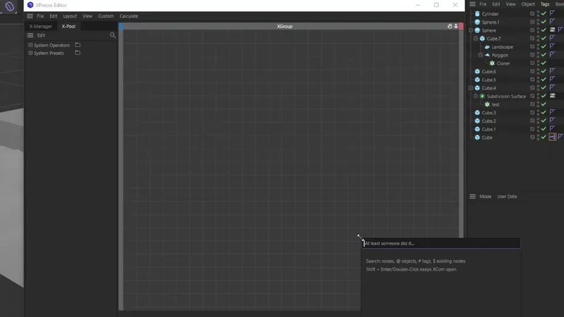

# ADVANCED SHIfT // 002  | Xpresso Commander

  
  
  
  
  
  

Searchbar for Xpresso Node Editor

# Features

- Search and spawn Xpresso nodes(Limitation: Xgroup Xpool presets are not supported)

- Search Objects using @

- Search Tags using #

- Search and focus on the node using $

- Tags and Objects search support Drag & Drop on canvas

# Installation

-  [DOWNLOAD](https://github.com/Thodos1/XCommander/releases/download/V.1.0.0/XCOMMANDER.zip) LATEST
-  Unpack into plugins folder
-  Default Hotkey is Shift+C with Target to Xpresso Editor(Plugin will be executed only when Xpresso Editor open)

# Notes

XCommander is based on the static list of System Operators.json.
Due to many limitations of Xpresso Xpool nodes creation is limited to Python presets only.

# Links

MAKSYM VYSOKOLOV

Website: https://cataclysm-vfx.com

Instagram: https://instagram.com/thodos998

Behance: https://behance.net/Thodos
